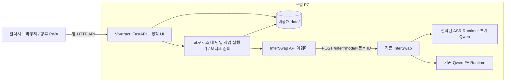

# 아키텍처

이 문서는 단계별 구현과 목표 설계를 설명한다. 현재 사용법은 [README](../README.md)를 따른다.

## 시스템과 책임



런타임 화살표는 논리적 책임 관계다. 1단계 소스 조사에서 InferSwap의 multipart 프록시 계약을 확인했다. [계약 기록](integration-contracts.md)이 근거·버전과 미검증 항목의 기준이다. 실행 서비스의 준비 상태와 실제 추론은 아직 검증하지 않았다.

| 구성 | 책임 |
| --- | --- |
| frontend | 초기 파일 선택, 상태 조회, 전사·단어 시간 표시, 내보내기 요청. 확장 시 링크 입력·ASR 선택 |
| HTTP 앱 | 요청 검증, 작업 접수·조회, 허용된 결과만 응답 |
| services | 파일 기반 큐의 단일 소비, 입력 준비 후 선택된 ASR→FA, 단계·시도 기록 |
| integrations | 확인된 외부 HTTP 계약과 앱 내부 결과·오류 의미 간 변환 |
| storage | 원본·메타데이터·중간 산출물·결과의 원자적 저장과 조회 |
| InferSwap | GPU 모델 자원과 추론 스케줄링 |
| Qwen 런타임 | ASR 또는 FA 추론 |

단일 Uvicorn 프로세스 안에서 앱 수명주기로 실행기 하나를 관리한다. 업로드 요청은 작업 영속화 후 반환한다. 추론은 사용자가 실행을 예약하면 시작한다.

## 목표 데이터 흐름

1. 비공개 임시 위치로 업로드를 스트리밍하며 크기·형식·디스크 여유를 검증한다.
2. 검증한 원본과 메타데이터를 서버 생성 작업 ID 아래에 확정한 뒤 큐에 넣는다.
3. 한 번에 하나의 작업을 처리한다. 입력을 canonical WAV로 한 번 준비하고, 같은 WAV를 ASR과 FA에 보낸다. ASR 원본 JSON을 저장한 뒤 해당 JSON의 청크별 텍스트·언어·sample 범위로 FA를 요청한다.
4. 전사, 단어 시간, 실행 근거를 앱 내부 결과 형식으로 저장한다.
5. UI는 우선 폴링으로 상태·완료 결과를 조회한다. 검증된 결과에서 내보내기를 생성한다.

목표 배치는 data/jobs/<job_id>/ 아래 원본, job.json, ASR 중간 결과, 최종 결과다. 같은 파일시스템에 임시 파일을 쓴 후 replace하며 부분 파일은 완료 결과로 공개하지 않는다. 메타데이터에 스키마 버전·상태·단계·시도 횟수·갱신 시각·오류 요약·결과 참조를 둔다. 구체적 필드와 결과 스키마는 추후 확정한다.

### 2단계 업로드와 대기 큐

- 브라우저는 `POST /api/jobs`에 파일 자체를 `application/octet-stream`으로 전송한다. `X-Filename`은 UTF-8 퍼센트 인코딩한 표시 이름이다. 경로 요소는 버리고 저장 경로에는 서버 생성 UUID만 쓴다.
- 한 프로세스에서 업로드 접수는 한 건씩 진행한다. 원본은 `data/jobs/.upload-<id>/original`에 스트리밍한다. 수신 완료 후 `ffprobe`로 오디오 스트림 하나와 허용 컨테이너·코덱을 확인하고, `ffmpeg`로 디코딩하며 길이를 검증한다. WAV는 8비트 unsigned PCM, 16·24·32비트 signed PCM, 32·64비트 float PCM을 지원한다. M4A는 트랙 재생 길이를 표시하고 재생 길이와 디코딩 길이에 각각 2시간 제한을 적용한다. 경계에서 트랙의 끝을 넘어 디코딩된 마지막 AAC 프레임의 패딩은 허용한다. 검사 중 변환 파일은 저장하지 않는다. 도구별 시간 제한은 probe 30초, decode 300초다.
- 원본과 `job.json`을 디스크에 동기화하고 임시 디렉터리를 `data/jobs/<id>/`로 원자적으로 이름 변경한 뒤 HTTP 201을 반환한다. 기록에는 스키마 버전, ID, 접수 순서, `queued` 상태, 표시 이름, 파일 바이트 수, 오디오 길이, 접수 시각을 둔다. `GET /api/jobs`는 접수 순 목록을, `GET /api/jobs/{id}`는 단일 기록을 반환한다.
- 전송 중 연결이 끊기거나 검증·저장에 실패하면 미확정 파일을 정리한다. 전송 완료 후 연결이 끊기면 서버가 접수를 마칠 수 있으므로 재업로드 전 작업 목록을 조회한다. 작업 조회·삭제는 접수 확정과 직렬화한다. `DELETE /api/jobs/{id}`는 대기 작업 디렉터리를 `.deleted-<id>`로 원자적으로 옮긴 뒤 제거한다. 데이터 디렉터리의 OS 파일 잠금을 보유한 인스턴스만 시작 시 미확정 업로드와 중단된 삭제를 청소한다.

### 1단계 조사에 따른 내부 경계

- `services/`는 ffprobe·ffmpeg 오디오 준비와 ASR→FA 순서를, `integrations/`는 외부 HTTP를, `storage/`는 파일 저장과 원자적 확정을 담당한다. 로컬 저장 경로는 서버 생성 ID로 정한다.
- 준비 출력은 16,000 Hz·모노·signed 16-bit PCM WAV다. AAC 디코더가 낸 트랙 끝 이후 패딩을 제외하고 원본 재생 구간을 유지한다. 분할 처리에서도 canonical sample을 빠짐없이 보존한다. 원본·WAV 해시, frame 수, 오디오 스트림, 변환 도구·설정을 비공개 메타데이터에 기록한다. 원본 재생과의 동기는 실제 샘플로 확인한다.
- ASR 어댑터는 raw 응답을 보존하는 한편 내부 전사 텍스트·언어·sample 범위로 변환한다. 현재 Qwen FA 어댑터가 필요로 하는 raw JSON은 비공개 연동 자료이며 HTTP 핸들러·UI가 그 구조에 의존하지 않게 한다.
- FA 어댑터는 sample 범위와 audio metadata를 확인하고 내부 정렬 항목(text·start·end·chunk 참조)으로 변환한다. 시간은 canonical 오디오 시작 기준의 유한한 초 값이다. FA 응답은 이미 전역 시간이므로 offset을 다시 더하지 않는다.
- 청크 간 겹침은 FA가 제거하지 않는다. raw 청크별 결과는 보존하고, 최종 표시용 항목은 3단계에서 정의·검증한 시간·텍스트 병합 규칙으로 만든다. 정확히 같은 문자열이라는 이유만으로 멀리 떨어진 실제 반복 발화를 삭제하지 않는다.
- 내부 결과에는 schema version, 전사·언어, 정렬 항목, audio 시간 기준, 사용 런타임·시도·입력/결과 참조를 포함하는 최소 형태를 사용한다. 세부 필드와 병합 알고리즘은 기능 구현 시 확정하며 두 번째 ASR 전 범용 인터페이스를 만들지 않는다.
- 성공 HTTP만으로 completed를 저장하지 않는다. audio·chunk 대응·상태·유한 시간·범위·필수 항목을 검사하고 최종 결과를 원자적으로 확정해야 한다. 비어 있지 않은 텍스트에 정렬 items가 없거나 일부 청크가 누락되면 정상 완료로 숨기지 않는다. 모두 빈 텍스트인 결과는 무음으로 단정하지 않고 빈 전사임을 명시한다.

### 3단계 순차 실행

- 기존 2단계 파일과 새로 접수한 파일은 `queued` 상태에서 대기한다. 작업 목록의 **전사 시작** 또는 **재시도**로 `POST /api/jobs/{id}/run`을 호출하면 실행을 예약한다. 최초 예약할 때 InferSwap 주소, 모델 ID, ASR served name, 분할 기준을 고정한다. `VOXTRACT_INFERSWAP_URL` 설정이 실행기를 활성화한다.
- 데이터 디렉터리 잠금을 공유하는 Uvicorn lifespan 실행기가 예약 작업을 접수 순서대로 한 건씩 처리한다. 상태는 `preparing → transcribing → aligning → completed`이고 진행 상태는 원자적으로 저장한다. 실행 중, 실행 예약 중, 외부 실행 불명 작업의 삭제는 거절한다.
- `inference/plan.json`은 입력·WAV 해시, 구간 범위, 검증된 구간별 ASR·FA 응답 참조와 해시를 보관한다. 준비 WAV와 ASR 입력 응답이 일치하는 체크포인트를 재사용한다. `attempt-N-part-M-{asr,fa}.raw`와 검증된 `result.json`은 비공개 자료다. 결과 저장 후 완료를 확정한다.
- WAV 생성 시 예상 공간을 예약하고 쓰기 블록마다 디스크 여유 1 GiB를 검사한다. InferSwap에는 길이를 명시한 multipart를 스트리밍한다. HTTP 응답 상한은 단계당 16 MiB이고 요청 전체 제한의 초기값은 7,200초다.

### 긴 입력의 분할 처리

입력 상한은 2시간이다. 분할 기준은 별도 서버 설정이며 30분은 실제 추론에서 검증할 초기값이다. [정책 결정](decisions.md#확정-입력-길이와-분할-처리-방향)

1. 전체 canonical WAV를 만든 뒤 sample 수를 기준으로 처리 구간을 나눈다. 기본 분할안은 `N=ceil(전체 sample 수 / threshold sample 수)`이며 각 구간의 길이를 대략 균등하게 한다. 핵심 구간은 `[floor(i*S/N), floor((i+1)*S/N))`로 두어 빈틈·중복 없이 전체를 덮는다. threshold는 핵심 구간의 목표 최대 길이이며 외부 API가 보장하는 한계값이 아니다.
2. VoXtract의 처리 구간과 런타임 내부 청크를 구분한다. 현재 ASR은 각 요청 안에서 120초·겹침 2초로 다시 나누고 FA는 그 ASR 청크 정보를 소비한다. VoXtract가 이 내부 청크 규칙을 복제하거나 런타임 설정을 바꾸지 않는다.
3. 모든 구간의 ASR을 순차 실행·저장한 뒤 모든 구간의 FA를 순차 실행한다. GPU 모델 로드·언로드는 InferSwap이 결정한다.
4. 각 구간의 ASR과 FA에는 동일한 구간 WAV를 보낸다. FA가 반환하는 시간은 그 구간 WAV 시작 기준이므로, 어댑터의 결과를 전체 시간축에 병합할 때 해당 구간 WAV의 시작 sample / 16000을 **한 번만** 더한다. FA 내부 120초 청크의 offset을 다시 더하지 않는다. 전체 파일을 직접 보낸 기존 경우에는 추가 offset이 0이다.
5. 분할 구간의 양 끝에 최대 2초의 인접 문맥을 붙인다. 짧은 분할 설정에서는 분할 기준의 10%로 문맥을 제한한다. 서로 다른 청크의 정렬 항목은 NFC·대소문자 정규화 텍스트가 같고 발화 시간과 오디오 범위가 겹칠 때 한 쌍씩 병합한다. 전사 본문은 구간별 문단으로 이어 붙이며 경계 반복이 남을 수 있다.
6. 부분 실패 뒤 명시적으로 재시도하면 검증된 구간 응답을 이어 쓴다. 모든 구간과 병합이 성공해야 완료로 저장한다.

분할 길이 경계, sample 범위, offset 및 실패 복구는 자동 검사로 다룬다. 실제 자연 발화의 경계 누락·중복과 2시간 처리 성능·품질은 미검증이다.

## 4단계 결과와 내보내기

- 작업 목록의 **결과 보기**는 완료된 작업의 내부 결과 v1을 읽는다. 화면·재생·다운로드 모두 같은 출처이며, 원본은 작업 ID로 조회하는 범위 요청 지원 오디오 응답으로 제공한다. 비공개 저장 경로와 외부 응답은 정적 자산에 포함하지 않는다.
- FA 정렬 항목을 순서대로 표시한다. 32개 항목, 첫 항목 기준 15초 또는 2초 이상 발화 공백에서 새 읽기 구간을 시작한다. 검색은 이 구간의 표시 텍스트에 적용한다. 길이가 0인 항목은 텍스트로 표시한다. 시간 버튼은 구간 안에서 길이가 있는 첫 정렬 항목으로 이동하고, 재생 시 해당 구간과 단어를 강조한다. 시간은 변환된 오디오 시작 기준의 초이며 원본 오디오에서 같은 위치를 사용한다.
- HTML은 앱과 같은 전사 구간·시간 표시·본문 스타일과 ASR 원문을 담는다. 오프라인 파일은 읽기용이고 앱 화면에서 오디오 재생과 동기 강조를 제공한다. TXT는 저장된 ASR 본문을 UTF-8로 제공한다. JSON v1은 본문·정렬 항목·시간 기준·단위·오디오 샘플 정보·언어·모델·시도를 내보내고, 처리 계획 참조와 외부 raw 응답은 비공개 자료로 유지한다. 내보내기는 응답으로 생성하며 data/에 새 파일을 남기지 않는다.

## 입력 확장 방향

갤럭시 녹음은 초기 사용 사례다. 목표 흐름은 입력 취득 → 오디오 검증·준비 → 선택된 ASR → FA → 결과다. 출처가 달라도 추론 단계는 준비된 로컬 오디오와 내부 작업 정보만 받는다.

| 입력 | 취득·준비 책임 | 범위 |
| --- | --- | --- |
| 갤럭시 녹음 | 업로드·형식 검증. 필요한 변환은 런타임 계약 확인 후 결정 | 초기 MVP |
| 다른 오디오·MP4 등 동영상 | 형식 검사, 오디오 트랙 선택·추출, 필요 시 변환 | MVP 후 확장 |
| YouTube 링크 | 허용 링크의 미디어 취득 후 동일한 오디오 준비 경로 사용 | 파일 입력 확장 이후 |

기존 services/integrations 경계에서 작은 모듈로 시작한다. 준비된 오디오를 ASR·FA에 일관되게 사용하고 트랙 선택·변환 정보와 원본 시간축의 관계를 기록한다. 자르기 등으로 시간축이 달라지면 결과의 기준을 명시한다.

링크 취득은 백엔드가 담당한다. 허용 호스트·리디렉션·내부 주소 접근 제한, 취득 크기·시간 제한, 중단·임시 파일 정리를 구현 전에 정한다. 원본 URL은 비공개 메타데이터로 취급하고 로그에 남기지 않는다. 취득 도구, 지원 코덱, 다운로드 가능한 링크 범위는 미정이다.

현재 상태 모델은 녹음 업로드 MVP 기준이다. 미디어·링크 확장 시 준비 단계를 구분하고 취득·변환 실패와 중단의 복구 정책을 추가한다. 아직 새 상태나 다운로드·변환 코드를 구현하지 않는다.

## ASR 런타임 선택 방향

초기에는 Qwen ASR 하나를 사용한다. 다른 ASR의 실제 계약이 확인되면 해당 어댑터와 선택 설정을 추가한다. 선택은 서버에 등록된 런타임 ID로 제한하며 임의 URL·모델 경로를 브라우저에서 받지 않는다. GPU 자원 관리는 계속 InferSwap의 책임이다. 새 런타임도 사용할 수 있는 InferSwap 연동 계약을 먼저 확인한다.

작업 접수 시 선택한 ASR과 적용 설정을 고정해 저장한다. 실행 후 확인 가능한 모델·버전도 기록하고 기본값 변경이 대기·재시도 작업에 소급되지 않게 한다. 다른 ASR로 다시 전사하면 기존 ASR/FA 결과를 혼용하지 않는 새 실행으로 취급한다.

어댑터는 서로 다른 응답을 내부 전사 텍스트·언어 등 필요한 최소 정보로 변환한다. 작업 조정·결과 UI는 Qwen 응답 구조를 알지 않는다. 두 번째 실제 구현 전 공통 기반 클래스, 동적 플러그인 로더, 범용 런타임 관리 API는 만들지 않는다.

FA는 초기 Qwen FA를 유지한다. 다른 ASR의 언어·텍스트 정규화·오디오 조건이 FA와 호환되는지 검증한 조합만 지원한다. ASR 선택이 FA 생략이나 정렬 성공을 보장하지 않는다. 공통 전사 스키마·선택 UI·설정 필드는 계약 확인 후 정한다.

## 생명주기와 복구

실행 실패는 failed, 실행 중 프로세스 종료 후 복구는 interrupted로 구분한다.

| 상황 | 원칙 |
| --- | --- |
| 업로드 중단·검증 실패 | 작업 접수를 확정하지 않는다. 임시 파일은 정리 대상이다. |
| 대기 중 서버 재시작 | 디스크 큐를 복구하고 저장된 접수 순서를 유지한다. |
| 준비·ASR·FA 중 서버 중단 | 시작 시 interrupted로 표시한다. 외부 실행 여부가 불명확하면 재전송하지 않고 다른 대기 작업의 추론도 보류한다. |
| ASR 실패 | FA를 실행하지 않는다. 단계·오류·시도를 저장한다. |
| FA 실패 | 원본·ASR 산출물을 유지하고 최종 완료로 표시하지 않는다. |
| 재시도 | 외부 실행이 끝났다고 확인된 경우 사용자 요청으로 다시 실행한다. 준비 파일 해시와 ASR 원본 응답이 일치하는 단계는 캐시에서 복구한다. |
| 결과 저장 실패 | completed로 바꾸지 않고 부분 결과를 공개하지 않는다. |

요청을 보내기 전에 `external_pending`을 영속화한다. 연결 확립 전 실패와 완료가 확인된 응답에서 보류를 해제한다. 전송 이후 타임아웃·연결 단절·종료 증거가 불충분한 오류는 재시작 뒤에도 보류를 유지한다.

### 외부 실행 보류 해제

운영자가 런타임에서 해당 작업의 실제 종료를 확인한다. InferSwap의 `/health` 성공과 모델의 `ready`는 개별 실행의 종료 증거로 사용할 수 없다. ASR 청크 예외 뒤에는 내부 vLLM 작업 종료까지 확인해야 한다. 실제 배포에서 종료를 확인하는 절차는 미검증이다. [계약 기록](integration-contracts.md#확인되지-않은-것과-후속-검증)

종료를 확인한 뒤 `JOB_ID`에 해당 ID를 넣고 보류를 해제한다. 다른 예약 작업은 실행될 수 있다. 보류됐던 작업을 다시 처리하려면 목록에서 **재시도**를 누른다.

```sh
curl --fail-with-body "http://127.0.0.1:8000/api/jobs/${JOB_ID}/resolve" \
  -H 'Content-Type: application/json' -d '{"runtime_idle_confirmed":true}'
```

실행 중 reload나 다중 worker를 사용하지 않는다.

보존·수동 삭제·임시 청소·디스크 여유 정책은 [결정 기록](decisions.md#확정-초기-입력저장내보내기)을 따른다. 원본 파일 바이트와 data/ 총용량의 고정 상한은 두지 않는다. 업로드를 스트리밍 저장하고 쓰기 전 디스크 여유를 검사하며 ENOSPC·중단 시 미확정 자료를 정리한다. 확정 작업은 기간·총량을 이유로 자동 삭제하지 않으며 삭제는 실행 중·외부 실행 불명 작업과 충돌하지 않아야 한다.

## InferSwap 계약 경계

브라우저는 InferSwap이나 런타임에 직접 접근하지 않는다. 어댑터는 ASR을 내부 텍스트로, FA를 정렬 항목의 텍스트·시작·끝으로 변환한다. 외부 시간 단위·언어 정규화는 계약 기록을 따르며 내부 표시·병합 규칙은 기능 구현 시 확정한다.

소스·로컬 설정으로 확인한 주소·모델 ID·요청/응답·오류·시간 제한·취소 의미는 [계약 기록](integration-contracts.md)에 둔다. 요청은 multipart bytes이며 공유 경로를 요구하지 않는다. VoXtract의 앱 작업 ID는 외부 job ID가 아니다. 실행 배포 버전·인증·연결 가능 여부와 승인 샘플 E2E는 3단계에서 다시 확인한다. 운영 설정의 실제 값이나 비밀값을 Git에 복제하지 않는다.

## PWA와 Tailscale

현재는 loopback HTTP 개발 서버다. 향후 개인 tailnet의 스마트폰과 PC 사이에 HTTPS 접근을 구성한다. 구체적 Tailscale 방식과 Windows/WSL 경계는 별도 검증한다.

PWA 단계에서 manifest·아이콘·설치를 추가한다. 서비스 워커 도입 시 정적 자산만 캐시하며 음성·전사·작업 API는 캐시하지 않는 방향이다. 서비스 워커는 secure context가 필요하며 스마트폰에서 PC의 일반 HTTP 주소로 접근하는 것은 localhost 개발 예외가 아니다. 오프라인 업로드 큐는 MVP에서 제외한다.

참고: [FastAPI 정적 파일](https://fastapi.tiangolo.com/tutorial/static-files/), [MDN 서비스 워커 보안 조건](https://developer.mozilla.org/en-US/docs/Web/API/Service_Worker_API).
