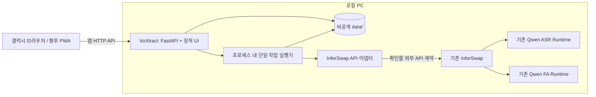

# 아키텍처

이 문서는 목표 설계다. 현재 구현 범위는 README를 따른다.

## 시스템과 책임

런타임 화살표는 논리적 책임 관계다. 실제 요청 전달·응답 방식과 오디오 전달 경로는 미확인이다.

| 구성 | 책임 |
| --- | --- |
| frontend | 파일 선택, 상태 조회, 전사·단어 시간 표시, 내보내기 요청 |
| HTTP 앱 | 요청 검증, 작업 접수·조회, 허용된 결과만 응답 |
| services | 파일 기반 큐의 단일 소비, ASR 성공 후 FA, 단계·시도 기록 |
| integrations | 확인된 외부 HTTP 계약과 앱 내부 결과·오류 의미 간 변환 |
| storage | 원본·메타데이터·중간 산출물·결과의 원자적 저장과 조회 |
| InferSwap | GPU 모델 자원과 추론 스케줄링 |
| Qwen 런타임 | ASR 또는 FA 추론 |

단일 Uvicorn 프로세스 안에 앱 수명주기로 관리되는 실행기 하나를 둘 예정이다. 요청 핸들러는 작업 영속화 후 반환하며 추론 완료까지 업로드 연결을 유지하지 않는다. 실행기는 미구현이다.

## 목표 데이터 흐름

1. 비공개 임시 위치로 업로드를 스트리밍하며 크기·형식·디스크 여유를 검증한다.
2. 검증한 원본과 메타데이터를 서버 생성 작업 ID 아래에 확정한 뒤 큐에 넣는다.
3. 한 번에 하나의 작업을 처리한다. ASR 결과를 저장한 뒤 해당 텍스트와 오디오로 FA를 요청한다.
4. 전사, 단어 시간, 실행 근거를 앱 내부 결과 형식으로 저장한다.
5. UI는 우선 폴링으로 상태·완료 결과를 조회한다. 검증된 결과에서 내보내기를 생성한다.

목표 배치는 data/jobs/<job_id>/ 아래 원본, job.json, ASR 중간 결과, 최종 결과다. 같은 파일시스템에 임시 파일을 쓴 후 replace하며 부분 파일은 완료 결과로 공개하지 않는다. 메타데이터에 스키마 버전·상태·단계·시도 횟수·갱신 시각·오류 요약·결과 참조를 둔다. 구체적 필드와 결과 스키마는 추후 확정한다.

## 생명주기와 복구

목표 상태: queued → transcribing → aligning → completed.
실행 실패는 failed, 실행 중 프로세스 종료 후 복구는 interrupted로 구분한다.

| 상황 | 원칙 |
| --- | --- |
| 업로드 중단·검증 실패 | 작업 접수를 확정하지 않는다. 임시 파일은 정리 대상이다. |
| 대기 중 서버 재시작 | 디스크 큐를 복구하고 저장된 접수 순서를 유지한다. |
| ASR/FA 중 서버 중단 | 시작 시 interrupted로 표시한다. 외부 실행 여부가 불명확하면 재전송하지 않는다. |
| ASR 실패 | FA를 실행하지 않는다. 단계·오류·시도를 저장한다. |
| FA 실패 | 원본·ASR 산출물을 유지하고 최종 완료로 표시하지 않는다. |
| 재시도 | 사용자 명시 재시도가 기본. 외부 작업 종료를 확인한 후 실행한다. 유효한 ASR 산출물이 있으면 FA부터 재개하는 방향이다. |
| 결과 저장 실패 | completed로 바꾸지 않고 부분 결과를 공개하지 않는다. |

요청 타임아웃은 외부 추론 종료를 뜻하지 않는다. 자동 재시도는 중복 실행 위험이 해소된 오류에만 제한적으로 적용할 수 있다. API의 멱등성·상태 조회·취소·요청 ID 의미 확인 전 자동 재전송하지 않는다. 상한과 시간 제한 값은 미정이다.

작업 실행기를 구현할 때 단일 인스턴스 잠금과 비정상 종료 복구를 함께 검증한다. 실행 중 reload나 다중 worker를 사용하지 않는다.

원본·실패 자료·완료 결과는 정책 확정 전 임의 자동 삭제하지 않는 설계다. 파일 처리 구현 전에 보존 기간·수동 삭제·용량 제한·임시 파일 청소 기준을 확정한다. 삭제는 실행 중 작업과 충돌하지 않아야 한다.

## InferSwap 계약 경계

브라우저는 InferSwap이나 런타임에 직접 접근하지 않는다. 어댑터는 ASR을 내부 텍스트로, FA를 단어·시작·끝으로 변환한다. 의미·단위·정규화는 실제 명세와 예제를 확인한 후 확정한다.

먼저 실제 운영 문서와 읽기 조사를 통해 접속 주소, 인증, 모델 ID, 오디오 전달, 동기/비동기 완료, FA 입력, 오류, 시간 제한, 조회·취소·중복 방지 지원을 기록한다. 확인 전 엔드포인트나 모의 응답을 만들지 않는다. 공유 경로가 필요하더라도 런타임 내부 경로를 임의로 가정하지 않는다.

## PWA와 Tailscale

현재는 loopback HTTP 개발 서버다. 향후 개인 tailnet의 스마트폰과 PC 사이에 HTTPS 접근을 구성한다. 구체적 Tailscale 방식과 Windows/WSL 경계는 별도 검증한다.

PWA 단계에서 manifest·아이콘·설치를 추가한다. 서비스 워커 도입 시 정적 자산만 캐시하며 음성·전사·작업 API는 캐시하지 않는 방향이다. 서비스 워커는 secure context가 필요하며 스마트폰에서 PC의 일반 HTTP 주소로 접근하는 것은 localhost 개발 예외가 아니다. 오프라인 업로드 큐는 MVP에서 제외한다.

참고: [FastAPI 정적 파일](https://fastapi.tiangolo.com/tutorial/static-files/), [MDN 서비스 워커 보안 조건](https://developer.mozilla.org/en-US/docs/Web/API/Service_Worker_API).
