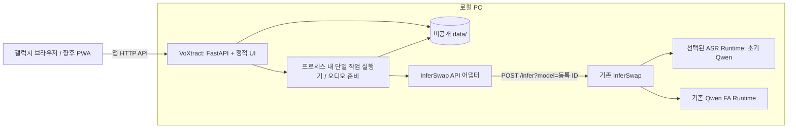

# 아키텍처

이 문서는 목표 설계다. 현재 구현 범위는 README를 따른다.

## 시스템과 책임

런타임 화살표는 논리적 책임 관계다. 1단계 소스 조사에서 InferSwap의 multipart 프록시 계약을 확인했다. [계약 기록](integration-contracts.md)이 근거·버전과 미검증 항목의 기준이다. 실행 서비스의 준비 상태와 실제 추론은 아직 검증하지 않았다.

| 구성 | 책임 |
| --- | --- |
| frontend | 초기 파일 선택, 상태 조회, 전사·단어 시간 표시, 내보내기 요청. 확장 시 링크 입력·ASR 선택 |
| HTTP 앱 | 요청 검증, 작업 접수·조회, 허용된 결과만 응답 |
| services | 파일 기반 큐의 단일 소비, 입력 준비 후 선택된 ASR→FA, 단계·시도 기록 |
| integrations | 확인된 외부 HTTP 계약과 앱 내부 결과·오류 의미 간 변환 |
| storage | 원본·메타데이터·중간 산출물·결과의 원자적 저장과 조회 |
| InferSwap | GPU 모델 자원과 추론 스케줄링 |
| Qwen 런타임 | ASR 또는 FA 추론 |

단일 Uvicorn 프로세스 안에 앱 수명주기로 관리되는 실행기 하나를 둘 예정이다. 요청 핸들러는 작업 영속화 후 반환하며 추론 완료까지 업로드 연결을 유지하지 않는다. 실행기는 미구현이다.

## 목표 데이터 흐름

1. 비공개 임시 위치로 업로드를 스트리밍하며 크기·형식·디스크 여유를 검증한다.
2. 검증한 원본과 메타데이터를 서버 생성 작업 ID 아래에 확정한 뒤 큐에 넣는다.
3. 한 번에 하나의 작업을 처리한다. 입력을 canonical WAV로 한 번 준비하고, 같은 WAV를 ASR과 FA에 보낸다. ASR 원본 JSON을 저장한 뒤 해당 JSON의 청크별 텍스트·언어·sample 범위로 FA를 요청한다.
4. 전사, 단어 시간, 실행 근거를 앱 내부 결과 형식으로 저장한다.
5. UI는 우선 폴링으로 상태·완료 결과를 조회한다. 검증된 결과에서 내보내기를 생성한다.

목표 배치는 data/jobs/<job_id>/ 아래 원본, job.json, ASR 중간 결과, 최종 결과다. 같은 파일시스템에 임시 파일을 쓴 후 replace하며 부분 파일은 완료 결과로 공개하지 않는다. 메타데이터에 스키마 버전·상태·단계·시도 횟수·갱신 시각·오류 요약·결과 참조를 둔다. 구체적 필드와 결과 스키마는 추후 확정한다.

### 1단계 조사에 따른 내부 경계

- `services/`는 입력 준비→ASR→FA 순서와 영속 상태를 소유한다. ffprobe/ffmpeg 실행·외부 HTTP는 `integrations/`, 로컬 파일 생성·읽기·원자적 확정·정리는 `storage/`에 둔다. 준비·검증에 필요한 경로는 서버가 생성하며 사용자 파일명으로 경로를 정하지 않는다.
- 준비 출력은 16,000 Hz·모노·signed 16-bit PCM WAV다. 전체 canonical 생성은 자르기·무음 제거·시간 늘이기를 하지 않는다. 이후 분할 처리에서도 전체 sample을 빠짐없이 보존한다. 원본 hash, canonical hash·frame count, 선택한 오디오 stream, 변환 도구·설정과 시간축 기준을 비공개 메타데이터에 기록한다. 실제 원본 재생과의 동기는 샘플 검증 전 보장하지 않는다.
- ASR 어댑터는 raw 응답을 보존하는 한편 내부 전사 텍스트·언어·sample 범위로 변환한다. 현재 Qwen FA 어댑터가 필요로 하는 raw JSON은 비공개 연동 자료이며 HTTP 핸들러·UI가 그 구조에 의존하지 않게 한다.
- FA 어댑터는 sample 범위와 audio metadata를 확인하고 내부 정렬 항목(text·start·end·chunk 참조)으로 변환한다. 시간은 canonical 오디오 시작 기준의 유한한 초 값이다. FA 응답은 이미 전역 시간이므로 offset을 다시 더하지 않는다.
- 청크 간 겹침은 FA가 제거하지 않는다. raw 청크별 결과는 보존하고, 최종 표시용 항목은 3단계에서 정의·검증한 시간·텍스트 병합 규칙으로 만든다. 정확히 같은 문자열이라는 이유만으로 멀리 떨어진 실제 반복 발화를 삭제하지 않는다.
- 내부 결과에는 schema version, 전사·언어, 정렬 항목, audio 시간 기준, 사용 런타임·시도·입력/결과 참조를 포함하는 최소 형태를 사용한다. 세부 필드와 병합 알고리즘은 기능 구현 시 확정하며 두 번째 ASR 전 범용 인터페이스를 만들지 않는다.
- 성공 HTTP만으로 completed를 저장하지 않는다. audio·chunk 대응·상태·유한 시간·범위·필수 항목을 검사하고 최종 결과를 원자적으로 확정해야 한다. 비어 있지 않은 텍스트에 정렬 items가 없거나 일부 청크가 누락되면 정상 완료로 숨기지 않는다. 모두 빈 텍스트인 결과는 무음으로 단정하지 않고 빈 전사임을 명시한다.

### 긴 입력의 분할 처리 설계안

입력 길이 상한·처리 threshold의 정책과 결정 상태는 [결정 기록](decisions.md#확정-입력-길이와-분할-처리-방향)을 따른다. 두 값은 독립적인 서버 설정으로 관리하고 작업 접수 시 고정하는 방향이다. 아래는 분할 방향을 구체화한 제안이며 3단계 구현·검증 전 확정된 실행 동작이 아니다.

1. 전체 canonical WAV를 만든 뒤 sample 수를 기준으로 처리 구간을 나눈다. 기본 분할안은 `N=ceil(전체 sample 수 / threshold sample 수)`이며 각 구간의 길이를 대략 균등하게 한다. 핵심 구간은 `[floor(i*S/N), floor((i+1)*S/N))`로 두어 빈틈·중복 없이 전체를 덮는다. threshold는 핵심 구간의 목표 최대 길이이며 외부 API가 보장하는 한계값이 아니다.
2. VoXtract의 처리 구간과 런타임 내부 청크를 구분한다. 현재 ASR은 각 요청 안에서 120초·겹침 2초로 다시 나누고 FA는 그 ASR 청크 정보를 소비한다. VoXtract가 이 내부 청크 규칙을 복제하거나 런타임 설정을 바꾸지 않는다.
3. 사용자에게는 작업 하나로 보이게 한다. 모든 구간의 ASR을 순차 실행·저장한 뒤 모든 구간의 FA를 순차 실행하는 순서를 우선 검토한다. 구간마다 ASR→FA를 반복하면 모델 전환이 늘 수 있다. InferSwap이 실제 GPU lifecycle을 결정하며 계속 모델이 상주한다고 보장하지 않는다.
4. 각 구간의 ASR과 FA에는 동일한 구간 WAV를 보낸다. FA가 반환하는 시간은 그 구간 WAV 시작 기준이므로, 어댑터의 결과를 전체 시간축에 병합할 때 해당 구간 WAV의 시작 sample / 16000을 **한 번만** 더한다. FA 내부 120초 청크의 offset을 다시 더하지 않는다. 전체 파일을 직접 보낸 기존 경우에는 추가 offset이 0이다.
5. 바깥 분할 경계가 단어·문장을 끊을 수 있으므로 인접 문맥을 추가하는 방안을 검토한다. 문맥 길이·경계 선택·중복 병합 규칙은 미정이다. 문맥이 붙은 실제 WAV의 시작 sample과 핵심 구간을 따로 기록하고, 요청 크기·시간 한계는 문맥을 포함한 실제 입력으로 검사한다. 내부 청크 겹침만으로 바깥 경계 문제가 해결됐다고 가정하지 않는다.
6. 분할 계획·입력 hash·sample 범위·설정·구간별 단계와 시도·결과 참조를 영속화한다. 완료된 구간은 검증 후 재사용하고 실패한 구간부터 명시적으로 재시도한다. 외부 실행 불명 시 보류 원칙은 그대로 적용한다. 단계 상태와 구간 진행률을 구분하며 필요한 모든 구간과 병합이 성공해야 completed다. 단계 경계 뒤 재시도 전이와 부분 실패 UI는 3단계에서 확정한다.

필수 후속 검증은 threshold 직전·정확히 경계·직후 길이, 2시간 상한, sample 보존, 바깥/내부 offset 중복 적용 방지, 경계 발화 누락·중복, 구간 실패·재시작·재시도, 파생 파일 용량 예약이다. 실제 2시간 처리 성능·품질은 아직 검증하지 않았다.

## 입력 확장 방향

갤럭시 녹음은 초기 사용 사례다. 목표 흐름은 입력 취득 → 오디오 검증·준비 → 선택된 ASR → FA → 결과다. 출처가 달라도 추론 단계는 준비된 로컬 오디오와 내부 작업 정보만 받는다.

| 입력 | 취득·준비 책임 | 범위 |
| --- | --- | --- |
| 갤럭시 녹음 | 업로드·형식 검증. 필요한 변환은 런타임 계약 확인 후 결정 | 초기 MVP |
| 다른 오디오·MP4 등 동영상 | 형식 검사, 오디오 트랙 선택·추출, 필요 시 변환 | MVP 후 확장 |
| YouTube 링크 | 허용 링크의 미디어 취득 후 동일한 오디오 준비 경로 사용 | 파일 입력 확장 이후 |

기존 services/integrations 경계에서 작은 모듈로 시작한다. 준비된 오디오를 ASR·FA에 일관되게 사용하고 트랙 선택·변환 정보와 원본 시간축의 관계를 기록한다. 자르기 등으로 시간축이 달라지면 결과의 기준을 명시한다.

링크 취득은 백엔드가 담당한다. 허용 호스트·리디렉션·내부 주소 접근 제한, 취득 크기·시간 제한, 중단·임시 파일 정리를 구현 전에 정한다. 원본 URL은 비공개 메타데이터로 취급하고 로그에 남기지 않는다. 취득 도구, 지원 코덱, 다운로드 가능한 링크 범위는 미정이다.

현재 상태 모델은 녹음 업로드 MVP 기준이다. 미디어·링크 확장 시 준비 단계를 구분하고 취득·변환 실패와 중단의 복구 정책을 추가한다. 아직 새 상태나 다운로드·변환 코드를 구현하지 않는다.

## ASR 런타임 선택 방향

초기에는 Qwen ASR 하나를 사용한다. 다른 ASR의 실제 계약이 확인되면 해당 어댑터와 선택 설정을 추가한다. 선택은 서버에 등록된 런타임 ID로 제한하며 임의 URL·모델 경로를 브라우저에서 받지 않는다. GPU 자원 관리는 계속 InferSwap의 책임이다. 새 런타임도 사용할 수 있는 InferSwap 연동 계약을 먼저 확인한다.

작업 접수 시 선택한 ASR과 적용 설정을 고정해 저장한다. 실행 후 확인 가능한 모델·버전도 기록하고 기본값 변경이 대기·재시도 작업에 소급되지 않게 한다. 다른 ASR로 다시 전사하면 기존 ASR/FA 결과를 혼용하지 않는 새 실행으로 취급한다.

어댑터는 서로 다른 응답을 내부 전사 텍스트·언어 등 필요한 최소 정보로 변환한다. 작업 조정·결과 UI는 Qwen 응답 구조를 알지 않는다. 두 번째 실제 구현 전 공통 기반 클래스, 동적 플러그인 로더, 범용 런타임 관리 API는 만들지 않는다.

FA는 초기 Qwen FA를 유지한다. 다른 ASR의 언어·텍스트 정규화·오디오 조건이 FA와 호환되는지 검증한 조합만 지원한다. ASR 선택이 FA 생략이나 정렬 성공을 보장하지 않는다. 공통 전사 스키마·선택 UI·설정 필드는 계약 확인 후 정한다.

## 생명주기와 복구

목표 상태: queued → preparing → transcribing → aligning → completed. preparing은 canonical 오디오 준비를 구분하기 위한 설계이며 아직 구현하지 않았다.
실행 실패는 failed, 실행 중 프로세스 종료 후 복구는 interrupted로 구분한다.

| 상황 | 원칙 |
| --- | --- |
| 업로드 중단·검증 실패 | 작업 접수를 확정하지 않는다. 임시 파일은 정리 대상이다. |
| 대기 중 서버 재시작 | 디스크 큐를 복구하고 저장된 접수 순서를 유지한다. |
| 준비·ASR·FA 중 서버 중단 | 시작 시 interrupted로 표시한다. 외부 실행 여부가 불명확하면 재전송하지 않고 다른 대기 작업의 추론도 보류한다. |
| ASR 실패 | FA를 실행하지 않는다. 단계·오류·시도를 저장한다. |
| FA 실패 | 원본·ASR 산출물을 유지하고 최종 완료로 표시하지 않는다. |
| 재시도 | 사용자 명시 재시도가 기본. 외부 작업 종료를 확인한 후 실행한다. 같은 canonical hash·ASR 설정·유효한 raw 응답이 있으면 FA부터 재개하는 방향이다. 입력·ASR 설정이 달라지면 기존 FA 결과를 재사용하지 않는다. |
| 결과 저장 실패 | completed로 바꾸지 않고 부분 결과를 공개하지 않는다. |

요청 타임아웃은 외부 추론 종료를 뜻하지 않는다. 자동 재시도는 중복 실행 위험이 해소된 오류에만 제한적으로 적용할 수 있다. API의 멱등성·상태 조회·취소·요청 ID 의미 확인 전 자동 재전송하지 않는다. 상한과 시간 제한 값은 미정이다.

확인한 InferSwap 공개 API에는 작업별 조회·취소·멱등 키 저장 기능이 없다. 연결 단절·timeout·응답 유실을 실행 실패 확정과 구분해 기록하고, 불명 상태는 서버 재시작 뒤에도 보존한다. /health 성공이나 /v1/models의 ready만으로 해당 작업 종료를 판단하지 않는다. 운영자의 runtime idle 확인과 명시적 해제 절차는 3단계에서 검증해야 한다. MVP에서 실행 중 취소 완료를 보장하는 UI는 제공하지 않는다.

ASR 청크 예외 뒤에는 facade의 active_requests=0만으로 내부 vLLM 종료까지 증명되지 않을 가능성이 있다. [계약 기록의 위험 항목](integration-contracts.md#확인되지-않은-것과-후속-검증)을 따라 실제 내부 실행까지 종료를 확인할 수 없는 경우 보류를 유지한다. 이 한계를 VoXtract의 임의 대기 시간이나 자동 모델 재시작으로 숨기지 않는다.

작업 실행기를 구현할 때 단일 인스턴스 잠금과 비정상 종료 복구를 함께 검증한다. 실행 중 reload나 다중 worker를 사용하지 않는다.

원본·실패 자료·완료 결과는 정책 확정 전 임의 자동 삭제하지 않는 설계다. 파일 처리 구현 전에 보존 기간·수동 삭제·용량 제한·임시 파일 청소 기준을 확정한다. 삭제는 실행 중 작업과 충돌하지 않아야 한다.

## InferSwap 계약 경계

브라우저는 InferSwap이나 런타임에 직접 접근하지 않는다. 어댑터는 ASR을 내부 텍스트로, FA를 정렬 항목의 텍스트·시작·끝으로 변환한다. 외부 시간 단위·언어 정규화는 계약 기록을 따르며 내부 표시·병합 규칙은 기능 구현 시 확정한다.

소스·로컬 설정으로 확인한 주소·모델 ID·요청/응답·오류·시간 제한·취소 의미는 [계약 기록](integration-contracts.md)에 둔다. 요청은 multipart bytes이며 공유 경로를 요구하지 않는다. VoXtract의 앱 작업 ID는 외부 job ID가 아니다. 실행 배포 버전·인증·연결 가능 여부와 승인 샘플 E2E는 3단계에서 다시 확인한다. 운영 설정의 실제 값이나 비밀값을 Git에 복제하지 않는다.

## PWA와 Tailscale

현재는 loopback HTTP 개발 서버다. 향후 개인 tailnet의 스마트폰과 PC 사이에 HTTPS 접근을 구성한다. 구체적 Tailscale 방식과 Windows/WSL 경계는 별도 검증한다.

PWA 단계에서 manifest·아이콘·설치를 추가한다. 서비스 워커 도입 시 정적 자산만 캐시하며 음성·전사·작업 API는 캐시하지 않는 방향이다. 서비스 워커는 secure context가 필요하며 스마트폰에서 PC의 일반 HTTP 주소로 접근하는 것은 localhost 개발 예외가 아니다. 오프라인 업로드 큐는 MVP에서 제외한다.

참고: [FastAPI 정적 파일](https://fastapi.tiangolo.com/tutorial/static-files/), [MDN 서비스 워커 보안 조건](https://developer.mozilla.org/en-US/docs/Web/API/Service_Worker_API).
